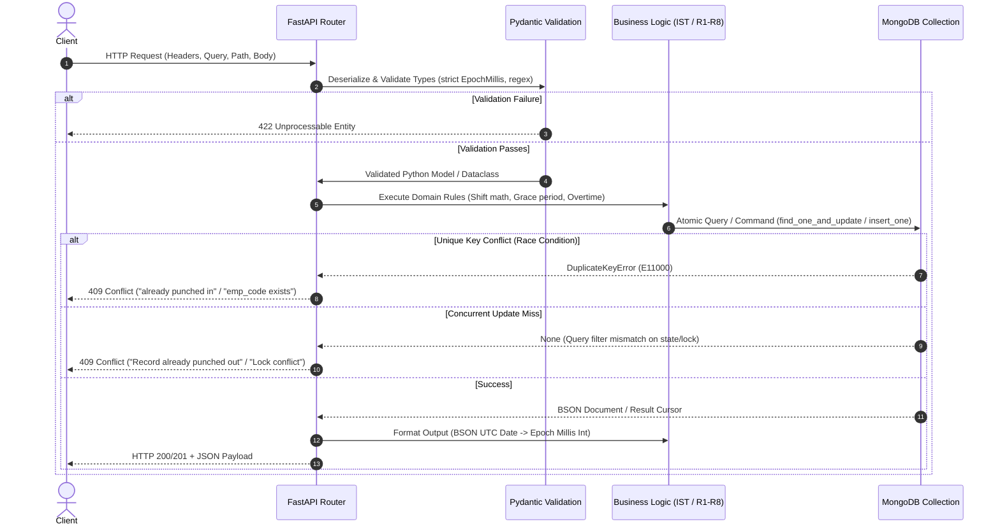

# Technical Architecture & Senior Backend Interview Guide

> **System:** Employee Attendance & Analytics API  
> **Framework:** FastAPI (Python 3.10+)  
> **Database:** MongoDB 6.0+ (PyMongo Driver)  
> **Timezone Anchor:** Indian Standard Time (IST, UTC+05:30)  
> **Author/Candidate:** Backend Software Engineering Intern  

---

## 1. Architecture, Request Flow, Data Models & Design Choices

### 1.1 High-Level System Architecture

```mermaid
graph TD
    Client[HTTP Client / Frontend / cURL] -->|HTTP / JSON / Epoch Millis| FastAPI[FastAPI Application Instance]
    
    subgraph FastAPI Runtime
        Lifespan[Lifespan Context Manager: db.*.create_index]
        Pydantic[Pydantic Models & Field Validators]
        Routing[FastAPI Route Handlers (def threadpool)]
        BizLogic[Domain Logic: IST Shifts, Decimal Rounding, Rules R1-R8]
        Pipelines[Shared MongoDB Aggregation Builders]
    end

    FastAPI --> Lifespan
    FastAPI --> Pydantic
    Pydantic --> Routing
    Routing --> BizLogic
    BizLogic --> Pipelines

    subgraph Persistence Layer MongoDB
        EmpColl[(Collection: employees)]
        AttColl[(Collection: attendance_logs)]
    end

    Pipelines -->|Native Aggregations / Commands| EmpColl
    Pipelines -->|Atomic Updates / Windowing| AttColl
```

#### Architectural Topology
- **API Engine:** FastAPI synchronous route handlers (`def`) executed across Starlette's threadpool workers to safely execute blocking PyMongo calls without blocking the async event loop.
- **Persistence Layer:** MongoDB document store configured with `tz_aware=True` to guarantee UTC-aware datetime parsing and serialization.
- **Computation Boundary:** Clear separation between ingestion compute (real-time punch state transitions) and analytics compute (database-native aggregation pipelines leveraging `$setWindowFields`, `$densify`, `$lookup`, and `$facet`/window accumulators).

---

### 1.2 End-to-End Request Flow



---

### 1.3 Data Models & Storage Schema

The persistence layer consists of two MongoDB collections. Neither collection uses synthetic autoincrement keys; documents are identified by natural business keys.

#### Collection 1: `employees`
- **Purpose:** Stores employee master data, department associations, and shift definitions.
- **Natural Key:** `emp_code` (e.g., `EMP0001`).

| Field | MongoDB BSON Type | HTTP API Type | Description & Constraints |
| :--- | :--- | :--- | :--- |
| `_id` | `ObjectId` | *Omitted* | MongoDB internal identifier (never exposed via API). |
| `emp_code` | `string` | `string` | Unique identifier. Format: `^EMP\d{4,6}$`. |
| `name` | `string` | `string` | Employee full name (1 to 100 characters). |
| `email` | `string` | `string` | Work email (valid email pattern, max 120 chars). |
| `department`| `string` | `string` | Department name (case-sensitive, 1 to 50 chars). |
| `shift_start`| `string` | `string` | IST shift start (`HH:MM`, 24-hr format). Default: `"09:30"`. |
| `shift_end` | `string` | `string` | IST shift end (`HH:MM`, 24-hr format). Default: `"18:30"`. Must differ from `shift_start`. |
| `joined_on` | `string` | `string` | Date of joining (`YYYY-MM-DD`). Used for mid-month working day math (R7). |
| `created_at`| `BSON Date` | `int` (epoch ms)| Timestamp when record was created (UTC instant truncated to whole seconds). |

#### Collection 2: `attendance_logs`
- **Purpose:** Daily attendance records, punch stamps, derived calculations, and audit history.
- **Natural Compound Key:** `(emp_code, date)` — strictly one record per employee per attendance day.

| Field | MongoDB BSON Type | HTTP API Type | Description & Constraints |
| :--- | :--- | :--- | :--- |
| `_id` | `ObjectId` | *Omitted* | MongoDB internal identifier. |
| `emp_code` | `string` | `string` | Reference to `employees.emp_code`. |
| `date` | `string` | `string` | Attendance day (`YYYY-MM-DD`). Anchored to IST shift start (R1). |
| `status` | `string` | `string` | One of: `PRESENT`, `WFH`, `ON_DUTY`, `ABSENT`, `LEAVE`. |
| `punch_in` | `BSON Date` / `null` | `int` (epoch ms) / `null`| UTC instant of punch-in. Null for `ABSENT`/`LEAVE`. |
| `punch_out`| `BSON Date` / `null` | `int` (epoch ms) / `null`| UTC instant of punch-out. Null until employee punches out. |
| `work_hours`| `double` / `null` | `float` / `null` | Total work duration in hours. Rounded half-up to 2 decimals. Null until punch-out. |
| `late_minutes`| `int` | `int` | Minutes past shift start if punch-in exceeds 10-min grace period (R2). Default: `0`. |
| `overtime_minutes`| `int` | `int` | Minutes worked past shift end if >= 30 minutes (R3). Default: `0`. |
| `half_day` | `bool` | `bool` | `true` if `work_hours < 4.50`, else `false` (R5). Default: `false`. |
| `history` | `array[object]`| `array[object]` | Audit trail of manual regularizations. Empty on initial punches. |

#### Sub-document: `history` Array Element
| Field | BSON Type | HTTP API Type | Description |
| :--- | :--- | :--- | :--- |
| `at` | `BSON Date` | `int` (epoch ms) | UTC timestamp when regularization occurred. |
| `by` | `string` | `string` | Identity of the modifier. |
| `reason` | `string` | `string` | Justification for edit (5 to 200 characters). |
| `changes` | `object` | `object` | Dictionary of changed fields: `{"<field>": {"from": val, "to": val}}`. |

---

### 1.4 Reasons Behind Core Design Choices

1. **Epoch Milliseconds at API Boundary vs. BSON Dates in Database:**
   - *Rationale:* JavaScript and external HTTP consumers handle integer epoch timestamps without timezone ambiguity or ISO-8601 string parsing variance. Inside MongoDB, native BSON Date types enable native temporal queries, `$dateToString`, and `$dateFromString` operations.
2. **Calendar Dates (`YYYY-MM-DD`) and Times (`HH:MM`) Stored as Strings:**
   - *Rationale:* A calendar date is a pure date coordinate, not an instant. Storing it as a UTC timestamp introduces timezone skew bugs (e.g., IST midnight becoming previous day 18:30 UTC). Plain strings keep date math deterministic.
3. **Database-Native Derived Values (`work_hours`, `late_minutes`, `overtime_minutes`):**
   - *Rationale:* Computed once at ingestion/mutation and written to the document. Analytics queries read stored, authoritative values directly, eliminating repetitive CPU overhead and discrepancies during reporting.
4. **Natural Key `(emp_code, date)` Compound Unique Index:**
   - *Rationale:* Replaces error-prone application-level "check-then-insert" logic with database-enforced atomicity, guaranteeing zero duplicate attendance records under high concurrency.
5. **Shared Aggregation Pipeline Builders:**
   - *Rationale:* The functions `build_employee_monthly_pipeline`, `build_department_summary_pipeline`, `build_late_leaderboard_pipeline`, and `build_department_trend_pipeline` are shared between production analytics endpoints and `/admin/explain/{endpoint}`, guaranteeing that execution stats reflect 100% identical query plans.

---

## 2. Complete Endpoint Reference

### 2.1 `GET /health`
- **Method & Path:** `GET /health`
- **Authentication:** None
- **Inputs:** None
- **Outputs (200 OK):**
  ```json
  { "status": "ok" }
  ```
- **Error Responses:**
  - `503 Service Unavailable`: `{"detail": "Database unavailable"}` if `db.command("ping")` raises an exception.
- **Design Rationale:** Actively probes database liveness via `ping` rather than returning a static mock, making it a reliable Kubernetes readiness/liveness probe.

---

### 2.2 `POST /employees`
- **Method & Path:** `POST /employees`
- **Status Code:** `201 Created`
- **Authentication:** None
- **Input (JSON Body - `EmployeeIn`):**
  ```json
  {
    "emp_code": "EMP1001",
    "name": "Jane Doe",
    "email": "jane.doe@example.com",
    "department": "Engineering",
    "shift_start": "09:30",
    "shift_end": "18:30",
    "joined_on": "2026-07-01"
  }
  ```
- **Validation Rules:**
  - `emp_code`: Matches `^EMP\d{4,6}$`.
  - `email`: Valid email format, max 120 chars.
  - `shift_start` & `shift_end`: Matches `^([01]\d|2[0-3]):[0-5]\d$`.
  - Validator: `shift_start != shift_end` (raises 422 if identical).
- **Output (201 Created):**
  ```json
  {
    "emp_code": "EMP1001",
    "name": "Jane Doe",
    "email": "jane.doe@example.com",
    "department": "Engineering",
    "shift_start": "09:30",
    "shift_end": "18:30",
    "joined_on": "2026-07-01",
    "created_at": 1782800400000
  }
  ```
- **Error Responses:**
  - `409 Conflict`: `{"detail": "emp_code already exists"}` (caught `DuplicateKeyError` on unique index).
  - `422 Unprocessable Entity`: Input schema or shift equality violation.

---

### 2.3 `GET /employees`
- **Method & Path:** `GET /employees`
- **Authentication:** None
- **Query Parameters:**
  - `department` (string, optional): Filter by department.
  - `page` (int, optional, default: 1, `ge=1`).
  - `page_size` (int, optional, default: 20, `ge=1`, `le=100`).
- **Output (200 OK):**
  ```json
  {
    "items": [
      {
        "emp_code": "EMP1001",
        "name": "Jane Doe",
        "email": "jane.doe@example.com",
        "department": "Engineering",
        "shift_start": "09:30",
        "shift_end": "18:30",
        "joined_on": "2026-07-01",
        "created_at": 1782800400000
      }
    ],
    "total": 1,
    "page": 1,
    "page_size": 20
  }
  ```
- **Error Responses:**
  - `422 Unprocessable Entity`: Invalid pagination parameters.

---

### 2.4 `POST /attendance/punch-in`
- **Method & Path:** `POST /attendance/punch-in`
- **Status Code:** `201 Created`
- **Authentication:** None
- **Input (JSON Body - `PunchInIn`):**
  ```json
  {
    "emp_code": "EMP1001",
    "punched_at": 1783310700000,
    "status": "PRESENT"
  }
  ```
  *(Note: `punched_at` is optional; if omitted, current UTC server time truncated to seconds is used).*
- **Business Logic Applied:**
  1. Validates employee existence in `employees` (returns 404 if missing).
  2. Resolves IST punch instant: `ts_ist = ts_utc.astimezone(IST)`.
  3. Resolves attendance date (Rule R1): If overnight shift (`shift_end <= shift_start`) and punch-in is before shift end, attributes to previous calendar day.
  4. Calculates `late_minutes` (Rule R2): 10-minute grace period. If punch-in > 10 min past `shift_start`, computes elapsed minutes from shift start; else 0.
- **Output (201 Created):**
  ```json
  {
    "emp_code": "EMP1001",
    "date": "2026-07-06",
    "status": "PRESENT",
    "punch_in": 1783310700000,
    "punch_out": null,
    "work_hours": null,
    "late_minutes": 15,
    "overtime_minutes": 0,
    "half_day": false,
    "history": []
  }
  ```
- **Error Responses:**
  - `404 Not Found`: `{"detail": "Employee not found"}`.
  - `409 Conflict`: `{"detail": "already punched in for this date"}` (on duplicate compound key).
  - `422 Unprocessable Entity`: Status invalid or `punched_at` out of bounds.

---

### 2.5 `GET /attendance`
- **Method & Path:** `GET /attendance`
- **Authentication:** None
- **Query Parameters:**
  - `emp_code` (string, optional)
  - `date_from` (string `YYYY-MM-DD`, optional)
  - `date_to` (string `YYYY-MM-DD`, optional)
  - `status` (string, optional)
  - `page` (int, default: 1, `ge=1`)
  - `page_size` (int, default: 20, `ge=1`, `le=100`)
- **Validation:**
  - If both `date_from` and `date_to` are provided and `date_from > date_to`, returns `422`.
- **Output (200 OK):**
  ```json
  {
    "items": [
      {
        "emp_code": "EMP1001",
        "date": "2026-07-06",
        "status": "PRESENT",
        "punch_in": 1783310700000,
        "punch_out": 1783344900000,
        "work_hours": 9.5,
        "late_minutes": 15,
        "overtime_minutes": 30,
        "half_day": false,
        "history": []
      }
    ],
    "total": 1,
    "page": 1,
    "page_size": 20
  }
  ```
- **Index Optimization:** Sorted by `date` desc, `emp_code` asc, matching index `[("date", -1), ("emp_code", 1)]`.

---

### 2.6 `POST /attendance/punch-out`
- **Method & Path:** `POST /attendance/punch-out`
- **Authentication:** None
- **Input (JSON Body - `PunchOutIn`):**
  ```json
  {
    "emp_code": "EMP1001",
    "punched_at": 1783344900000
  }
  ```
- **Business Logic Applied:**
  1. Checks employee existence (404 if missing).
  2. Queries most recent attendance log for `emp_code` where `punch_in != None` sorted by `punch_in: -1`.
  3. Validations:
     - Record missing -> `404 Not Found`.
     - `record.punch_out` already populated -> `409 Conflict`.
     - `punched_at <= record.punch_in` -> `422 Unprocessable Entity`.
     - `(punched_at - punch_in) > 24 hours` -> `422 Unprocessable Entity`.
  4. Compute `work_hours` (Rule R4): `(punch_out - punch_in) / 3600`, rounded half-up to 2 decimals using `Decimal`.
  5. Compute `overtime_minutes` (Rule R3): Minutes past shift end (accounts for next-day shift end if overnight). Counted only if `>= 30`, else 0.
  6. Compute `half_day` (Rule R5): `work_hours < 4.50`.
  7. Atomic Update: `find_one_and_update({"_id": record["_id"], "punch_out": None}, {"$set": ...})`. Returns 409 if another process punched out concurrently.
- **Output (200 OK):**
  - Full updated `AttendanceRecord`.
- **Error Responses:**
  - `404 Not Found`: Employee or open record not found.
  - `409 Conflict`: Record already punched out.
  - `422 Unprocessable Entity`: Timestamp interval violations.

---

### 2.7 `PATCH /attendance/{emp_code}/{date}`
- **Method & Path:** `PATCH /attendance/{emp_code}/{date}`
- **Authentication:** None
- **Input (JSON Body - `RegularizeIn`):**
  ```json
  {
    "status": "PRESENT",
    "punch_in": 1783311600000,
    "punch_out": 1783344000000,
    "reason": "Biometric scanner glitch at entry",
    "regularized_by": "HR_ADMIN_01"
  }
  ```
- **Business Logic Applied:**
  1. Validates employee and existing attendance record exist (404 if missing).
  2. If status is `ABSENT` or `LEAVE`: Rejects if `punch_in` or `punch_out` are passed (422). Sets punch times and work hours to null, late/overtime to 0.
  3. If presence status (`PRESENT`, `WFH`, `ON_DUTY`):
     - Requires `punch_in`.
     - Verifies `punch_in` resolves to target path `date` in IST (422 if mismatched).
     - Recalculates `late_minutes`, `work_hours`, `overtime_minutes`, `half_day`.
  4. Diff Detection: Compares old vs. new state. If no values changed, rejects with `422 ("Request changes nothing")`.
  5. Audit History: Appends entry to `history` array with UTC `at`, `by`, `reason`, and changed keys `{from, to}`.
  6. Optimistic Concurrency Control: Matches `{"_id": record["_id"], "history": {"$size": cur_history_len}}`. Returns `409 Conflict` if another update intervened.
- **Output (200 OK):**
  - Updated `AttendanceRecord` with appended history.
- **Error Responses:**
  - `404 Not Found`: Employee or record not found.
  - `409 Conflict`: Concurrent regularization conflict.
  - `422 Unprocessable Entity`: Validation failure or no-op update.

---

### 2.8 `GET /analytics/employees/{emp_code}/monthly`
- **Method & Path:** `GET /analytics/employees/{emp_code}/monthly`
- **Authentication:** None
- **Query Parameters:**
  - `month` (string `YYYY-MM`, regex validated).
- **Path Parameters:**
  - `emp_code` (string).
- **Business Logic Applied:**
  1. Validates employee exists (404).
  2. Calculates calendar working days (Monday–Friday) in month.
  3. Mid-Month Joiner Adjustment (Rule R7): Working days count begins from `max(month_start, employee.joined_on)`.
  4. Executes MongoDB aggregation pipeline:
     - Matches `emp_code` and date range.
     - Sums `present_days` (Rule R6: `PRESENT`, `WFH`, `ON_DUTY` on Mon–Fri count as 1.0; half-day counts as 0.5).
     - Sums `leave_days`, `late_count`, `total_late_minutes`, `total_overtime_minutes`.
  5. Calculates `attendance_pct = (present_days / working_days) * 100`, rounded half-up to 2 decimals (or `null` if 0 working days).
- **Output (200 OK):**
  ```json
  {
    "emp_code": "EMP1001",
    "month": "2026-07",
    "working_days": 23,
    "present_days": 21.5,
    "leave_days": 1,
    "late_count": 3,
    "total_late_minutes": 45,
    "total_overtime_minutes": 60,
    "attendance_pct": 93.48
  }
  ```
- **Error Responses:**
  - `404 Not Found`: Employee does not exist.
  - `422 Unprocessable Entity`: Invalid month format.

---

### 2.9 `GET /analytics/departments/summary`
- **Method & Path:** `GET /analytics/departments/summary`
- **Authentication:** None
- **Query Parameters:**
  - `month` (string `YYYY-MM`, required).
  - `department` (string, optional).
- **Business Logic & Aggregation (Rule R9):**
  - Pipeline roots on **`employees`** matching `joined_on <= month_end` (and department if specified).
  - Performs `$lookup` into `attendance_logs` for that month.
  - *Zero-Log Headcount Guarantee:* Employees with zero attendance logs still contribute `1` to `headcount`.
  - Calculates department aggregates: `present_days`, `avg_work_hours` (work hours sum / completed days count), `late_count`, `total_late_minutes`, `leave_count`, `on_duty_count`.
- **Output (200 OK):**
  ```json
  {
    "month": "2026-07",
    "items": [
      {
        "department": "Engineering",
        "headcount": 15,
        "present_days": 310.5,
        "avg_work_hours": 8.75,
        "late_count": 12,
        "total_late_minutes": 180,
        "leave_count": 8,
        "on_duty_count": 4
      }
    ]
  }
  ```
- **Error Responses:**
  - `422 Unprocessable Entity`: Invalid month format.

---

### 2.10 `GET /analytics/leaderboard/late`
- **Method & Path:** `GET /analytics/leaderboard/late`
- **Authentication:** None
- **Query Parameters:**
  - `month` (string `YYYY-MM`, required).
  - `limit` (int, default: 10, `ge=1`, `le=50`).
  - `department` (string, optional).
- **Business Logic & Aggregation:**
  - Matches `attendance_logs` where `date` in month and `late_minutes > 0`.
  - Groups by `emp_code`, summing `late_minutes` and late count.
  - Joins `employees` to retrieve `name` and `department`.
  - Window ranking: `$setWindowFields` with `sortBy: {total_late_minutes: -1}` and `$rank: {}` (standard competition ranking: 1, 2, 2, 4).
  - Cutoff: Matches `rank <= limit` (ties at cutoff rank are all included).
  - Secondary Sort: `total_late_minutes` desc, `emp_code` asc.
- **Output (200 OK):**
  ```json
  {
    "month": "2026-07",
    "items": [
      {
        "rank": 1,
        "emp_code": "EMP1003",
        "name": "Bob Smith",
        "department": "Sales",
        "total_late_minutes": 120,
        "late_count": 4
      }
    ]
  }
  ```
- **Error Responses:**
  - `422 Unprocessable Entity`: Invalid month or limit parameter.

---

### 2.11 `GET /analytics/departments/{department}/trend`
- **Method & Path:** `GET /analytics/departments/{department}/trend`
- **Authentication:** None
- **Path Parameters:** `department` (string).
- **Query Parameters:**
  - `from` (string `YYYY-MM-DD`, required).
  - `to` (string `YYYY-MM-DD`, required).
- **Business Logic & Aggregation:**
  1. Validates department exists (checks employee count; returns 404 if 0).
  2. Validates `to >= from` and date range `<= 92 days` (returns 422 if exceeded).
  3. Pipeline sequence:
     - Roots on 1 employee document to initialize date boundaries.
     - `$densify` generates continuous calendar day sequence from `from` to `to`.
     - Computes `is_working_day` (`$isoDayOfWeek <= 5`).
     - `$lookup` to `employees` for active roster (`joined_on <= date`) -> computes daily `headcount`.
     - `$lookup` to `attendance_logs` for date and valid department employees -> computes `present_count` and `late_count`.
     - Calculates daily `attendance_rate = present_count / headcount` on working days (null on weekends).
     - `$setWindowFields`: Computes 7-day moving average (`moving_avg_7d`) using document window `[-6, "current"]`.
- **Output (200 OK):**
  ```json
  {
    "department": "Engineering",
    "items": [
      {
        "date": "2026-07-06",
        "is_working_day": true,
        "headcount": 10,
        "present_count": 9.5,
        "late_count": 1,
        "attendance_rate": 0.95,
        "moving_avg_7d": 0.95
      }
    ]
  }
  ```
- **Error Responses:**
  - `404 Not Found`: Department has 0 employees.
  - `422 Unprocessable Entity`: Range > 92 days or invalid dates.

---

### 2.12 `GET /admin/explain/{endpoint}`
- **Method & Path:** `GET /admin/explain/{endpoint}`
- **Authentication:** None
- **Path Parameters:** `endpoint` (`attendance_list`, `employee_monthly`, `department_summary`, `late_leaderboard`, `department_trend`).
- **Query Parameters:** Matches parameters of target endpoint.
- **Execution:** Runs `db.command("explain", ..., verbosity="executionStats")` on the exact pipeline/query used in production.
- **Output (200 OK):**
  ```json
  {
    "endpoint": "attendance_list",
    "collection": "attendance_logs",
    "explain": {
      "queryPlanner": { ... },
      "executionStats": {
        "executionSuccess": true,
        "nReturned": 20,
        "totalKeysExamined": 20,
        "totalDocsExamined": 20,
        "executionStages": {
          "stage": "FETCH",
          "inputStage": {
            "stage": "IXSCAN",
            "indexName": "date_-1_emp_code_1"
          }
        }
      }
    }
  }
  ```
- **Error Responses:**
  - `422 Unprocessable Entity`: Unknown endpoint name or missing parameters.

---

## 3. Module & Endpoint Cross-Questions (5 per Endpoint)

### 3.1 `GET /health`
1. **[Easy] What does `/health` actually verify under the hood?**  
   *Answer:* It executes PyMongo's `db.command("ping")`. If MongoDB responds, it returns `{"status": "ok"}`; otherwise, it catches the exception and raises HTTP 503.
2. **[Easy] Why return HTTP 503 instead of HTTP 500 when the database is down?**  
   *Answer:* 503 Service Unavailable explicitly informs load balancers and orchestrators that the service is temporarily incapable of handling requests, preventing routing traffic to unhealthy pods.
3. **[Medium] Is `ping` a sufficient health check for a write-heavy service?**  
   *Answer:* `ping` checks round-trip network connectivity and basic server responsiveness, but not write quorum, replica set write-lock health, or disk exhaustion. A write probe would be needed for full write readiness.
4. **[Medium] Since FastAPI runs async, does `db.command("ping")` block the event loop?**  
   *Answer:* No. Because `health()` is defined with `def` rather than `async def`, FastAPI automatically delegates its execution to any available worker thread in Starlette's threadpool.
5. **[Hard] How would you prevent `/health` from hanging indefinitely if MongoDB encounters a network partition?**  
   *Answer:* By configuring `serverSelectionTimeoutMS` and `socketTimeoutMS` on `MongoClient` (e.g., 2000ms), guaranteeing that `db.command("ping")` aborts quickly rather than blocking worker threads.

---

### 3.2 `POST /employees`
1. **[Easy] How is uniqueness of `emp_code` enforced?**  
   *Answer:* Through MongoDB's unique index on `emp_code` created during startup. Duplicate insertions trigger PyMongo's `DuplicateKeyError`, which the handler maps to HTTP 409.
2. **[Easy] Why does the handler reject `shift_start == shift_end`?**  
   *Answer:* A 0-minute shift makes shift calculations degenerate and impossible to classify as day or overnight. Pydantic's `validate_shifts` validator raises a `ValueError` (HTTP 422).
3. **[Medium] Why does the code use `datetime.now(timezone.utc)` and truncate to seconds for `created_at`?**  
   *Answer:* Rule R1 mandates that instants are truncated to whole seconds. The code calculates integer seconds via `int(timestamp())` before creating the UTC datetime, ensuring clean epoch conversion.
4. **[Medium] What happens if two requests create the same `emp_code` at the exact same millisecond?**  
   *Answer:* Both execute `db.employees.insert_one()`. MongoDB's unique index accepts the first atomic write and throws error code 11000 on the second. The second catches `DuplicateKeyError` and returns 409.
5. **[Hard] Why did you choose client-generated business IDs (`EMPxxxx`) over MongoDB's default `_id` ObjectIds?**  
   *Answer:* `emp_code` reflects HR natural business identity. Relying on business keys avoids leaky database abstractions, allows deterministic API path routing, and simplifies compound index lookups.

---

### 3.3 `GET /employees`
1. **[Easy] How is pagination offset calculated in `list_employees`?**  
   *Answer:* Via `skip = (page - 1) * page_size`. For page 1, skip is 0; for page 2 with page size 20, skip is 20.
2. **[Easy] In what order are employees returned?**  
   *Answer:* In ascending order of `emp_code` using `.sort("emp_code", 1)` to provide deterministic pagination.
3. **[Medium] Does `total` count the entire collection or only filtered documents?**  
   *Answer:* It executes `db.employees.count_documents(q)`, accurately returning only the count of documents matching the query filter (such as `department`).
4. **[Medium] Which index supports `GET /employees?department=Engineering`?**  
   *Answer:* The index on `department` or the compound index `[("department", 1), ("joined_on", 1)]` allows MongoDB to perform an `IXSCAN` on the department filter.
5. **[Hard] What is the performance danger of using `.skip(skip).limit(page_size)` as the dataset grows to millions of rows?**  
   *Answer:* Offset pagination traverses and discards `skip` index keys in O(N) time. For deep pagination at scale, keyset/cursor-based pagination (`emp_code > last_seen_code`) should be used instead.

---

### 3.4 `POST /attendance/punch-in`
1. **[Easy] What happens if an unknown `emp_code` attempts to punch in?**  
   *Answer:* The handler queries `db.employees.find_one({"emp_code": body.emp_code})`. If missing, it immediately aborts with HTTP 404 "Employee not found".
2. **[Easy] What are the valid status strings accepted for punch-in?**  
   *Answer:* Pydantic's regex enforces exactly `^(PRESENT|WFH|ON_DUTY)$`. Values like `ABSENT` or `LEAVE` cannot be created via punch-in.
3. **[Medium] How does the system attribute an overnight punch-in (e.g., 02:00 AM for a 22:00–06:00 shift) to the right day?**  
   *Answer:* In `get_attendance_date`, if `shift_end <= shift_start` and the punch-in time in IST is earlier than `shift_end`, it subtracts 1 day from the calendar date, attributing it to the previous day's shift start (Rule R1).
4. **[Medium] How is the 10-minute grace period evaluated in `compute_late_minutes`?**  
   *Answer:* It measures elapsed seconds: `diff_sec = int((punch_in_ist - start_dt).total_seconds())`. If `diff_sec > 600`, it returns `diff_sec // 60` from shift start. If `<= 600`, it returns 0 (Rule R2).
5. **[Hard] Why does punch-in use `insert_one` rather than an `upsert` or check-then-insert?**  
   *Answer:* A check-then-insert has a race window between `find_one` and `insert_one`. Attempting `insert_one` directly relies on the `(emp_code, date)` unique index to atomically guarantee exactly one punch-in per day, turning race conditions into handled 409 errors.

---

### 3.5 `GET /attendance`
1. **[Easy] How is sorting handled for the attendance list?**  
   *Answer:* It sorts by `[("date", -1), ("emp_code", 1)]`, showing the most recent dates first, and ordering tied dates by employee code ascending.
2. **[Easy] What happens if a client passes `date_from=2026-07-10` and `date_to=2026-07-01`?**  
   *Answer:* The route explicitly checks `date_from > date_to` and raises HTTP 422 with `"date_from must not be after date_to"`.
3. **[Medium] Which database index satisfies the default query `GET /attendance`?**  
   *Answer:* The compound index `[("date", -1), ("emp_code", 1)]`. It satisfies both the range and the exact sort order without requiring an in-memory sort stage (`SORT`).
4. **[Medium] Why does the query use `{"_id": 0}` or format the record explicitly rather than returning raw BSON?**  
   *Answer:* `format_attendance_record` converts BSON UTC datetime objects into integer epoch milliseconds and strips internal `_id` ObjectIds to match the API contract.
5. **[Hard] If a user filters by both `emp_code` and date range, which index does MongoDB choose, and is it optimal?**  
   *Answer:* MongoDB picks `(emp_code, 1), (date, 1)`. Because `emp_code` is an exact match and `date` is a range match, it achieves an optimal index scan where `totalDocsExamined == nReturned`.

---

### 3.6 `POST /attendance/punch-out`
1. **[Easy] What validation ensures a punch-out is chronological?**  
   *Answer:* The handler checks `ts_utc <= record["punch_in"]`. If true, it raises HTTP 422 with `"punched_at must be strictly after punch_in"`.
2. **[Easy] What is the maximum allowed duration between punch-in and punch-out?**  
   *Answer:* 24 hours (86,400 seconds). Exceeding this raises HTTP 422 with `"punched_at must be within 24 hours of punch_in"`.
3. **[Medium] How is the half-day flag determined?**  
   *Answer:* `work_hours` is calculated via `(punch_out - punch_in) / 3600` rounded half-up to 2 decimals using `Decimal`. If `work_hours < 4.50`, `half_day` is set to `True`; otherwise `False` (Rule R5).
4. **[Medium] How does `compute_overtime` calculate overtime for overnight shifts?**  
   *Answer:* If `shift_end <= shift_start`, the shift end datetime is advanced by 1 calendar day (`d += timedelta(days=1)`). Overtime is elapsed minutes past this end time, returned only if `>= 30`, otherwise 0 (Rule R3).
5. **[Hard] How does `punch_out` prevent race conditions between two concurrent requests?**  
   *Answer:* It executes an atomic `find_one_and_update({"_id": record["_id"], "punch_out": None}, {"$set": ...})`. The `punch_out: None` filter acts as an atomic compare-and-swap (CAS). The first request updates the document; the second fails the filter, receives `None`, and raises HTTP 409.

---

### 3.7 `PATCH /attendance/{emp_code}/{date}`
1. **[Easy] Can a client supply punch times when regularizing status to `ABSENT` or `LEAVE`?**  
   *Answer:* No. The handler explicitly checks: if target status is `ABSENT` or `LEAVE` and `punch_in` or `punch_out` are provided, it raises HTTP 422.
2. **[Easy] What happens if a regularization request makes zero changes to the record?**  
   *Answer:* The code diffs `old_fields` against `new_fields`. If `changes` dictionary is empty, it raises HTTP 422 with `"Request changes nothing"`.
3. **[Medium] Why does the handler require `punch_in` to match the path `date` in IST?**  
   *Answer:* Because the natural record identity is `(emp_code, date)`. Regularizing punch-in to an instant belonging to a different attendance date would violate the integrity of the daily log.
4. **[Medium] Why are punch times converted to epoch milliseconds inside the `history` changes object?**  
   *Answer:* In MongoDB, `from` and `to` are stored as BSON Dates. During response formatting, `format_history_entry` explicitly traverses the `changes` dictionary and converts BSON Dates to integer epoch milliseconds to adhere to the OpenAPI schema.
5. **[Hard] Explain the concurrency lock used in `regularize_attendance`.**  
   *Answer:* It uses optimistic concurrency control (OCC) via array size: `{"_id": record["_id"], "history": {"$size": cur_history_len}}`. If a concurrent request modifies history in the interim, the length changes, the CAS query matches 0 documents, and the runner raises HTTP 409.

---

### 3.8 `GET /analytics/employees/{emp_code}/monthly`
1. **[Easy] What days of the week are counted as working days?**  
   *Answer:* Mondays through Fridays (calendar days where `cur.weekday() < 5`). Saturdays and Sundays are excluded.
2. **[Easy] How does a half-day contribute to `present_days`?**  
   *Answer:* In the MongoDB `$group` aggregation stage, if `half_day == True`, it adds `0.5`; otherwise it adds `1.0` (Rule R6).
3. **[Medium] How are mid-month joiners handled in working day calculations?**  
   *Answer:* The loop sets `actual_start = max(month_start, employee.joined_on)`. Working days are counted only from `actual_start` to the end of the month, ensuring attendance percentage is not penalized for days before joining (Rule R7).
4. **[Medium] What happens if an employee has zero working days in a month (e.g., joined after the month ended)?**  
   *Answer:* `working_days` is 0, and `attendance_pct` is set to `None` (serialized as `null`) rather than causing a division-by-zero error.
5. **[Hard] Why does the aggregation filter `$isoDayOfWeek <= 5` for presence counts?**  
   *Answer:* Rule R6 mandates that presence is counted only on official working days (Monday to Friday). If an employee punches in on a weekend, the pipeline ignores it for `present_days` calculation.

---

### 3.9 `GET /analytics/departments/summary`
1. **[Easy] Which collection does this pipeline query first?**  
   *Answer:* It starts on the `employees` collection, not `attendance_logs`.
2. **[Easy] How is `avg_work_hours` calculated?**  
   *Answer:* It sums `work_hours` across all present days with completed punch-outs and divides by the count of those days, rounded half-up to 2 decimals using `Decimal`.
3. **[Medium] Why does the pipeline root on `employees` instead of `attendance_logs`?**  
   *Answer:* To solve the "zero-log headcount" requirement (Rule R9). If an employee was on leave or had no attendance logs all month, starting from `attendance_logs` would omit them. Starting from `employees` guarantees they count toward `headcount`.
4. **[Medium] How does the pipeline prevent employees who joined next month from being counted?**  
   *Answer:* The initial match stage on `employees` filters `{"joined_on": {"$lte": month_end}}`, ensuring future joiners do not inflate the historical headcount.
5. **[Hard] What index strategy is essential for the `$lookup` inside this department summary?**  
   *Answer:* Inside `$lookup`, the pipeline matches `{"$and": [{"$eq": ["$emp_code", "$$emp"]}, {"$gte": ["$date", start]}, {"$lte": ["$date", end]}]}`. The unique index `[("emp_code", 1), ("date", 1)]` on `attendance_logs` provides direct `IXSCAN` coverage for every correlated employee subquery.

---

### 3.10 `GET /analytics/leaderboard/late`
1. **[Easy] What ranking system is used on the leaderboard?**  
   *Answer:* Standard competition ranking (`1, 2, 2, 4`), computed via MongoDB's `$rank` window operator.
2. **[Easy] How are ties sorted on identical late minutes?**  
   *Answer:* By `emp_code` ascending (`{"total_late_minutes": -1, "emp_code": 1}`).
3. **[Medium] Why does the pipeline match `late_minutes > 0` before grouping?**  
   *Answer:* To filter out non-late records early, utilizing the index `[("date", 1), ("late_minutes", 1)]` and reducing the volume of documents piped into `$group`.
4. **[Medium] How does the endpoint handle ties at the cutoff rank (e.g., limit=10)?**  
   *Answer:* It filters `{"rank": {"$lte": limit}}` rather than applying a hard limit on document count. If multiple employees tie for rank 10, all of them are returned.
5. **[Hard] Why is `$setWindowFields` preferred over doing the ranking in Python application memory?**  
   *Answer:* Running `$setWindowFields` inside MongoDB lets the database engine handle sort-based window partitions natively in C++ before transmitting results over the network, drastically reducing serialization and payload size.

---

### 3.11 `GET /analytics/departments/{department}/trend`
1. **[Easy] What is the maximum allowable date range for the trend query?**  
   *Answer:* 92 days (`(d_to - d_from).days + 1 > 92` raises HTTP 422).
2. **[Easy] What does the endpoint return if the department does not exist?**  
   *Answer:* It counts documents in `employees` for that department. If 0, it raises HTTP 404 with `"Department not found"`.
3. **[Medium] What is the purpose of MongoDB's `$densify` stage in this pipeline?**  
   *Answer:* It generates missing dates in the time series sequence between `from` and `to` with a step of 1 day, ensuring weekends and zero-attendance days are present in the trend output.
4. **[Medium] Over what window is `moving_avg_7d` calculated?**  
   *Answer:* In `$setWindowFields`, the window is defined as `{"documents": [-6, "current"]}` sorted by `date: 1`, computing the arithmetic average of `attendance_rate` across up to 7 consecutive days.
5. **[Hard] How does the pipeline dynamically evaluate headcount for each day in the trend?**  
   *Answer:* For each densified date, a correlated `$lookup` inspects `employees` where `joined_on <= date` and `department == department`. The daily headcount is computed as `{"$size": "$dept_emps"}`, accounting for employees joining mid-period.

---

### 3.12 `GET /admin/explain/{endpoint}`
1. **[Easy] What explain verbosity mode is executed?**  
   *Answer:* `"executionStats"`, which returns both the query planner decision and the actual runtime execution metrics.
2. **[Easy] Can this endpoint explain arbitrary MongoDB queries?**  
   *Answer:* No. It only accepts a whitelist of 5 production endpoints (`attendance_list`, `employee_monthly`, `department_summary`, `late_leaderboard`, `department_trend`). Unknown values return HTTP 422.
3. **[Medium] Why does the code use `SON` objects when constructing the explain command?**  
   *Answer:* BSON command specifications in MongoDB require strict key ordering (e.g., `"explain"` must be the first key in the command document). Python standard dictionaries do not guarantee BSON key order serialization.
4. **[Medium] Why is `json_util.dumps` piped through `json.loads` before returning?**  
   *Answer:* MongoDB explain outputs contain BSON-specific types (`ISODate`, `NumberLong`). `json_util.dumps` serializes them into Extended JSON, and `json.loads` converts them back to standard Python dicts for FastAPI JSON response serialization.
5. **[Hard] In the explain output, what indicates an index scan vs. a collection scan?**  
   *Answer:* An index scan shows an execution stage of `"IXSCAN"`, with `totalDocsExamined` close to `nReturned`. A collection scan shows `"COLLSCAN"`, indicating MongoDB had to read every document from disk or cache.

---

## 4. Deep Dive: Scaling, Security, Concurrency, Caching, Testing & Deployment

### 4.1 Concurrency & Race Conditions
- **Q: How does the system handle simultaneous punch-in requests from the same employee?**  
  *Answer:* The collection has a unique compound index on `(emp_code, date)`. Simultaneous requests both compute the IST attendance date and execute `insert_one`. The database engine atomically permits only one write; the other triggers a `DuplicateKeyError`, caught by the application to return HTTP 409.
- **Q: How does `punch-out` ensure two concurrent requests don't both succeed?**  
  *Answer:* Through an atomic compare-and-swap update: `db.attendance_logs.find_one_and_update({"_id": record["_id"], "punch_out": None}, {"$set": ...})`. The `punch_out: None` filter is satisfied by only one process; the second matches zero documents, returns `None`, and triggers HTTP 409.
- **Q: How are regularizations protected against concurrent edits?**  
  *Answer:* Through optimistic concurrency control (OCC). The query matches `{"history": {"$size": cur_history_len}}`. If two admins edit simultaneously, the first write increments the array length, causing the second write to fail the size check and return HTTP 409.

### 4.2 Scaling to 100x Data Volume (~10 Million Documents)
- **Q: Where will the current architecture bottleneck first at 100x data scale?**  
  *Answer:* In the cross-collection `$lookup` operations inside `department_summary` and `department_trend`. Correlating thousands of employees with daily logs during real-time HTTP requests will consume excessive CPU and RAM.
- **Q: How would you re-architect analytics queries for 10M records?**  
  *Answer:* Shift from compute-on-read to compute-on-write using pre-aggregated materialized views (e.g., `daily_department_stats`). Updates can be maintained incrementally via MongoDB Change Streams or Celery background workers.
- **Q: How would you shard this database across a cluster?**  
  *Answer:* Shard `attendance_logs` using a hashed compound shard key like `{emp_code: "hashed", date: 1}` to evenly distribute punch traffic across shards while keeping daily queries for an individual employee localized.

### 4.3 Security & Hardening
- **Q: What security measures are currently missing from the codebase?**  
  *Answer:* There is no authentication (JWT/OAuth2), authorization/RBAC, rate limiting, CORS configuration, or TLS enforcement in the FastAPI application.
- **Q: How would you secure the audit trail in `PATCH /attendance/{emp_code}/{date}`?**  
  *Answer:* Replace the client-supplied `regularized_by` string with the authenticated user ID extracted from a validated JWT bearer token, preventing identity spoofing.
- **Q: Is the application vulnerable to NoSQL injection?**  
  *Answer:* No. All inputs pass through strict Pydantic models with type checking, string lengths, and regex constraints. Field values are passed to PyMongo as parameterized dictionary literals, not raw JavaScript `$where` expressions.

### 4.4 Caching Strategy
- **Q: Which endpoints are prime candidates for caching?**  
  *Answer:* Historical analytics endpoints: `GET /analytics/employees/{emp_code}/monthly` and `GET /analytics/departments/summary` for past months (e.g., `2026-06`).
- **Q: How would you implement caching for past vs. current month queries?**  
  *Answer:* Cache closed historical months in Redis with a long TTL (e.g., 30 days) since historical records rarely change. For the current month, either do not cache or use a short TTL (e.g., 60 seconds) invalidated whenever a punch or regularization occurs for that month.

### 4.5 Testing Strategy
- **Q: How would you structure a production-grade automated test suite for this application?**  
  *Answer:* 
  1. *Unit Tests:* Test business logic helpers (`compute_late_minutes`, `compute_work_hours`, `compute_overtime`, `get_attendance_date`) with edge cases (leap years, DST non-shifts, midnight boundaries).
  2. *Integration Tests:* Use `pytest` with `testcontainers-python` spinning up a real ephemeral MongoDB container to verify index creations, `$densify`, and `$setWindowFields`.
  3. *Concurrency Tests:* Use Python's `asyncio` or `concurrent.futures` to fire 50 simultaneous punch-in/punch-out requests against single records to assert race condition immunity.

### 4.6 Deployment & Operations
- **Q: How would you package and deploy this service to production?**  
  *Answer:* Containerize using a multi-stage Dockerfile running Python 3.11-slim, managed by `uvicorn` workers behind a Gunicorn process manager (`gunicorn -w 4 -k uvicorn.workers.UvicornWorker app.main:app`). Deploy to Kubernetes with horizontal pod autoscalers (HPA) CPU-targeted at 70%.
- **Q: Why should `create_index` be moved out of the application lifespan in production?**  
  *Answer:* In multi-pod deployments, running `create_index` on every pod startup creates redundant database load and can trigger index build locks during rolling deployments. Index creation should be managed via automated database migration scripts (e.g., Liquibase or custom migration runners).

---

## 5. Code Weaknesses & Rehearsed Answers

| Category | Specific Code Weakness | Rehearsed Candidate Defense / Answer |
| :--- | :--- | :--- |
| **Validation** | `joined_on` and `date` path parameters use regex patterns but do not validate calendar validity (e.g., `2026-02-31` passes regex). | *"Currently, Pydantic checks the ISO string format `^\d{4}-\d{2}-\d{2}$`. In production, I would enhance the validator to parse the string with `datetime.date.fromisoformat` to ensure calendar correctness and catch leap-year anomalies before hitting the database."* |
| **N+1 / Sub-queries** | `department_trend` executes correlated `$lookup` sub-pipelines on every single densified calendar day. | *"In the current design, `$densify` generates calendar days, and `$lookup` evaluates headcounts and logs per day. While acceptable for the 92-day limit, under high load I would pre-query all department logs in a single range `$match` and assemble the daily buckets in memory or via a `$group` stage."* |
| **Missing Indexes** | Low-cardinality standalone index on `status` in `attendance_logs`. | *"The single-field index on `status` has low cardinality (5 values) and is rarely selective on its own. I would drop it in favor of a compound index like `[("status", 1), ("date", -1)]` or rely on the primary `(date, emp_code)` index."* |
| **Error Handling** | Synchronous PyMongo calls run inside FastAPI threadpools without global handling for transient connection loss. | *"The app currently relies on Starlette's threadpool for sync PyMongo calls and catches connection failure in `/health`. In a mature setup, I would migrate to `Motor` for native async I/O and attach a FastAPI global exception handler for `pymongo.errors.PyMongoError` to return clean 503 errors."* |
| **Missing Tests** | No automated tests (`pytest`) are committed in the repository—only manual cURL checks and a database seeder script. | *"The project demonstrates correctness via sample seeding and `/admin/explain` validation. The immediate next priority is setting up a `pytest` suite with `testcontainers` to automate edge case regression and concurrency load tests in CI/CD."* |
| **Client Reliability** | OCC in regularizations returns 409 without automatic retry mechanisms. | *"The 409 response strictly adheres to REST principles by alerting the caller to a state conflict. However, for internal client libraries, I would implement exponential backoff retry wrappers or handle safe auto-merges for non-conflicting fields."* |

---

## 6. 60-Minute Senior Backend Interview Script & Rubric

### 6.1 Timeline & Interview Structure

```
[00:00 - 05:00]  05 min  Introduction & Architecture Overview
[05:00 - 20:00]  15 min  Data Modeling, Timezones & Business Logic (R1 - R8)
[20:00 - 35:00]  15 min  Concurrency, Race Conditions & Atomic Operations
[35:00 - 45:00]  10 min  Database Aggregations & Query Optimization
[45:00 - 55:00]  10 min  Rapid-Fire Technical Questions (10 questions)
[55:00 - 60:00]  05 min  Behavioral Scenarios & Wrap-up
```

---

### 6.2 Detailed Interviewer Script with Timings

#### [00:00 - 05:00] Stage 1: Architecture Walkthrough
- **Interviewer Prompt:** *"Walk me through the high-level architecture of your attendance API. How does a request travel from the client to MongoDB, and why did you choose FastAPI with PyMongo?"*
- **Candidate Speakable Answer:**  
  *"The system is a FastAPI backend backed by MongoDB. Incoming requests pass through Pydantic models for strict type validation. Route handlers execute domain rules like IST shift mapping and rounding, then interact with MongoDB collections using atomic operators and native aggregation pipelines. I chose FastAPI for fast schema validation and automatic OpenAPI generation, and PyMongo for robust, production-grade BSON document manipulation."*

---

#### [05:00 - 20:00] Stage 2: Timezones & Domain Logic (Rules R1 - R8)
- **Interviewer Prompt:** *"Timezones and overnight shifts are notoriously buggy. How did you anchor the system to IST, and how do you handle a punch-in at 2:00 AM for a night shift starting at 10:00 PM?"*
- **Candidate Speakable Answer:**  
  *"All external timestamps arrive as UTC epoch milliseconds and are converted to IST using a fixed UTC+05:30 offset. In `get_attendance_date`, if a shift is overnight—meaning `shift_end <= shift_start`—and an employee punches in before `shift_end`, the logic subtracts one day. This guarantees a 2:00 AM punch on Tuesday is correctly attributed to Monday's shift."*
- **Interviewer Prompt:** *"Why did you use Python's `Decimal` module instead of standard floats for work hours?"*
- **Candidate Speakable Answer:**  
  *"Standard Python `round()` performs banker's rounding—round half to even—which rounds 2.125 down to 2.12. The business rules explicitly mandate strict half-up rounding. By using `Decimal.quantize` with `ROUND_HALF_UP`, 2.125 correctly rounds to 2.13."*

---

#### [20:00 - 35:00] Stage 3: Concurrency, Locking & Atomicity
- **Interviewer Prompt:** *"Two identical punch-in requests arrive at the exact same millisecond for the same employee. Walk me step-by-step through how your code prevents duplicate records."*
- **Candidate Speakable Answer:**  
  *"I avoid check-then-insert logic because it has a race window. Instead, both requests attempt `insert_one`. The database has a unique compound index on `(emp_code, date)`. MongoDB's engine atomically writes the first document and throws a `DuplicateKeyError` on the second. The handler catches this error and returns a clean HTTP 409 Conflict."*
- **Interviewer Prompt:** *"How do you prevent two supervisors from overwriting each other's changes when regularizing an attendance record?"*
- **Candidate Speakable Answer:**  
  *"I implemented optimistic concurrency control using MongoDB's `$size` operator on the `history` array. The update query matches `_id` and checks `history: {"$size": cur_history_len}`. The first update appends an entry, incrementing the array length. The second update fails the query match, returns `None`, and raises HTTP 409."*

---

#### [35:00 - 45:00] Stage 4: Aggregations & Query Performance
- **Interviewer Prompt:** *"In your department summary, how do you ensure an employee who has zero attendance logs this month is still counted in the department headcount?"*
- **Candidate Speakable Answer:**  
  *"The aggregation roots on the `employees` collection rather than `attendance_logs`. It filters by `joined_on <= month_end` and performs a `$lookup` into `attendance_logs`. Even if an employee has zero logs, their document still flows through the pipeline and contributes 1 to the department headcount."*
- **Interviewer Prompt:** *"How do you prove that your queries don't trigger full collection scans in production?"*
- **Candidate Speakable Answer:**  
  *"Through `/admin/explain/{endpoint}`, which runs `db.command('explain', verbosity='executionStats')`. Every analytics endpoint has been verified to use `IXSCAN` on compound indexes, examining only the matching keys without in-memory `SORT` or `COLLSCAN` stages."*

---

### 6.3 10 Rapid-Fire Technical Questions

1. **Q: What is the exact difference between an instant and a calendar date in your schema?**  
   *A:* An instant is a specific moment in time stored as a UTC BSON Date; a calendar date is a plain `"YYYY-MM-DD"` string without timezone bias.
2. **Q: Why does punch-in strictly disallow strings or floats for `punched_at`?**  
   *A:* Pydantic's `Field(..., strict=True)` enforces pure integer epoch milliseconds to prevent accidental precision truncation or string coercion errors.
3. **Q: What does Rule R3 require for overtime?**  
   *A:* Overtime must be at least 30 minutes past shift end; anything under 30 minutes evaluates to 0.
4. **Q: Can an employee punch out without an existing punch-in?**  
   *A:* No. The handler looks for the most recent open record; if missing, it returns HTTP 404.
5. **Q: What HTTP status code is returned if an edit changes no values?**  
   *A:* HTTP 422 Unprocessable Entity with the detail `"Request changes nothing"`.
6. **Q: How does the late leaderboard handle ranking ties?**  
   *A:* It uses `$rank`, assigning standard competition ranks (`1, 2, 2, 4`), and includes all tied employees within the cutoff.
7. **Q: Does `history` record initial punch-ins or punch-outs?**  
   *A:* No. `history` is strictly an audit log for manual regularizations.
8. **Q: Why is MongoDB's `_id` excluded from the API responses?**  
   *A:* The domain uses natural business keys (`emp_code`, `date`); leaking internal `ObjectId` values violates the API abstraction contract.
9. **Q: What is the moving average window size in the trend endpoint?**  
   *A:* 7 days, defined as `{"documents": [-6, "current"]}` in `$setWindowFields`.
10. **Q: What happens if MongoDB goes down while the app is running?**  
    *A:* `/health` returns HTTP 503, and ongoing database operations raise unhandled connection errors until recovery.

---

### 6.4 5 Behavioral Questions Tied to This Project

1. **"Describe a design trade-off you had to make in this codebase."**  
   *Candidate Answer:*  
   *"I traded off write throughput for absolute audit integrity in regularizations. By placing an optimistic concurrency lock on the history array length, concurrent writes to the same record fail with 409 instead of merging automatically. I chose safety over convenience because financial payroll relies on an uncorrupted audit trail."*
2. **"How did you approach debugging the overnight shift logic?"**  
   *Candidate Answer:*  
   *"I isolated the date resolution into a pure helper function, `get_attendance_date`. I wrote concrete test cases spanning 23:55 PM, 00:05 AM, and 05:59 AM for a 22:00 to 06:00 shift to confirm that punches before shift end consistently map to the preceding calendar day."*
3. **"If a product manager asked you to allow 3 punch-ins per day for flexible shifts, how would you handle it?"**  
   *Candidate Answer:*  
   *"I would explain that our current data model relies on a unique compound key on `(emp_code, date)`. Supporting multiple punches requires migrating to an array of punch sessions or a child `punch_events` collection. I would outline the schema migration plan and discuss performance impacts on daily rollups."*
4. **"What would you do if your explain plans revealed a COLLSCAN under load?"**  
   *Candidate Answer:*  
   *"I would inspect the filter and sort predicates in the query planner output. If an equality filter preceded a range, I would follow the Equality-Sort-Range (ESR) rule to construct a targeted compound index and verify `IXSCAN` coverage using `/admin/explain`."*
5. **"How do you ensure your code remains maintainable by other engineers?"**  
   *Candidate Answer:*  
   *"I centralized complex aggregation pipelines into reusable builder functions shared between analytics and explain endpoints. I documented every business rule mapping (R1–R8) directly in docstrings and kept domain calculations free of side effects."*

---

### 6.5 Assumptions Declared

1. **IST Daylight Saving Time:** It is assumed that Indian Standard Time (IST) has a constant offset of UTC+05:30 with no Daylight Saving Time adjustments.
2. **Single Primary Database:** It is assumed that MongoDB operates as a replica set or Atlas cluster where unique indexes provide immediate write consistency.
3. **Working Days Definition:** It is assumed that working days are exclusively Monday through Friday, excluding statutory public holidays (unless modeled via approved leave).
4. **Natural Key Immutability:** It is assumed that `emp_code` is permanently assigned by HR and never mutated.
5. **Threadpool Execution:** It is assumed that Starlette's threadpool default capacity is sufficient for synchronous PyMongo calls at expected intern-project concurrency levels.
